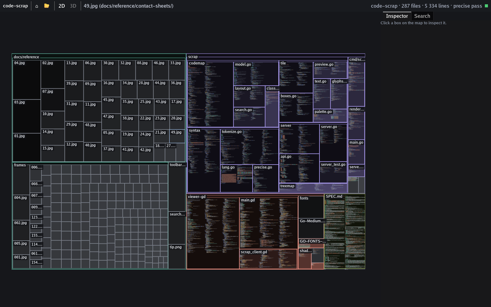
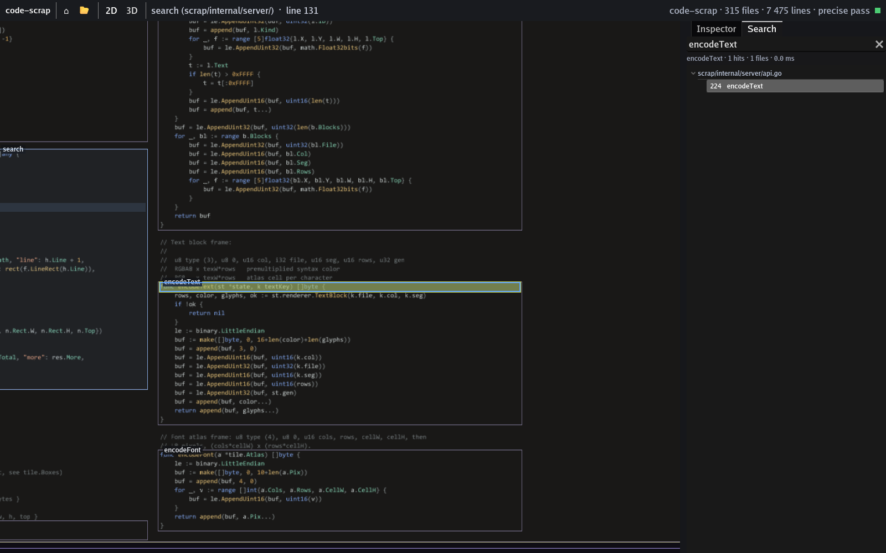
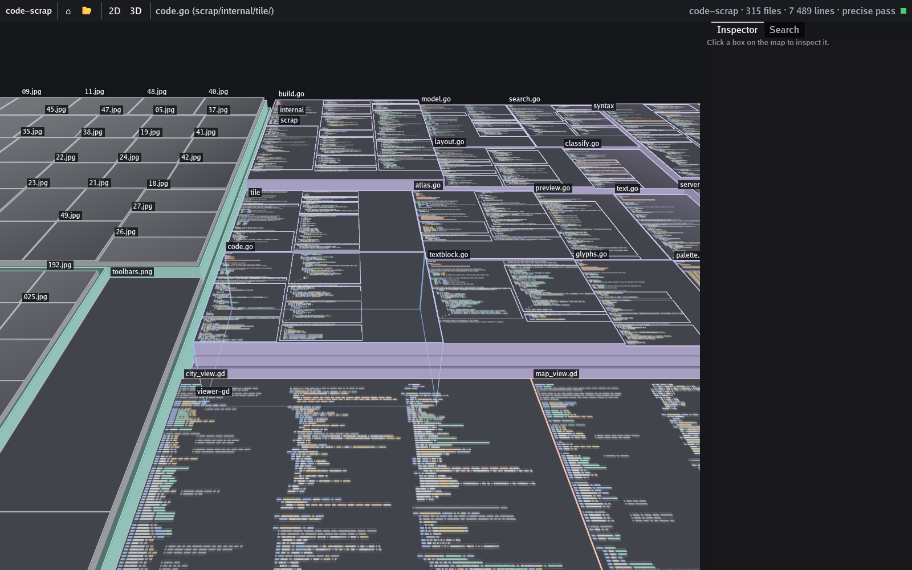

# code-scrap

A zoomable map of a codebase. The whole repository is one surface: directories, files and code scopes are nested boxes, and you zoom from the overview down to readable, syntax-highlighted code without opening anything. It's inspired by Rik Arends' Makepad Scope; see [SPEC.md](SPEC.md) for the design and [docs/reference](docs/reference) for frames from the Scope demo.







## Layout

| Path | What |
|---|---|
| `scrap/` | Go indexer and tile server (`scrap` command) |
| `viewer-gd/` | Godot 4.7 viewer in GDScript |
| `viewer-cs/` | Godot 4.7 .NET viewer in C# (planned; same server and protocol) |
| `docs/reference/` | Frames of the Makepad Scope demo used for the spec |

All heavy work happens in `scrap`:
- file enumeration (`git ls-files`)
- tokenizing and scope finding (a fast heuristic pass, then a precise tree-sitter pass via [gotreesitter](https://github.com/odvcencio/gotreesitter), pure Go)
- layout
- symbol search
- tiles:
  - vector box tiles, as ready-to-upload MultiMesh buffers
  - raster code tiles: line dashes when zoomed out, Go Mono glyphs when zoomed in

The viewers only stream tiles, draw them, and handle the UI.

## Run

Requires Go 1.26+ and Godot 4.7. On Windows, `build-n-run.bat [repo-path]` builds the server and opens the viewer (set `GODOT` to override the Godot path). Or step by step:

```bash
cd scrap && go build -o bin/scrap.exe ./cmd/scrap
```

```bash
godot --path viewer-gd -- --repo=D:/path/to/some/repo
```

The viewer starts `scrap serve` itself if nothing is listening on `ws://127.0.0.1:7878/ws`. You can also run the server yourself:

```bash
scrap/bin/scrap.exe serve -addr 127.0.0.1:7878 D:/path/to/some/repo
```

### Viewer controls

| Input | Action |
|---|---|
| Wheel / pinch | zoom toward the cursor (3D: toward the roof or wall under it) |
| Drag | pan · 3D: right drag or Shift+drag orbits |
| Click | select → Inspector |
| Double-click | fly to the box under the cursor |
| `Tab` / **2D**·**3D** | switch between the flat map and the 3D city |
| `/` | search symbols (prefix); **Enter** / **Shift+Enter** step through hits |
| `Home` | fit the whole repo |
| `F` | fit the selection |
| `Backspace` | select and fly to the parent |
| `Esc` | clear search |

### Lenses (toolbar)

Every lens is optional; the defaults show the plain map.

| Lens | What it does |
|---|---|
| **height** | 3D building height: *Nesting* (terraces), *Flat*, or a metric: lines, complexity, functions, churn, recent change, authors |
| **color** | *Area* hue, or the same metrics as a blue → red percentile ramp |
| **importance** | shrink vendored, test, generated, asset and data files so the core code gets the space |
| **imports** | arcs from the selection to what it imports (orange) and from what imports it (blue) |
| **calls** | arcs to what the selected function/file calls (violet) and from its callers (green); syntax-level, ambiguous names skipped |

Git lenses read `git log` for the last 12 months in the background (`scrap serve -git-since` changes the window).

### CLI

```
scrap stats  [-precise] <path>                 summary: sizes, classes, most complex functions
scrap search [-precise] <path> <prefix>        symbol prefix search
scrap render [-precise] -n 4 <path> <z> <x> <y> out.png
scrap render -file <substr> -lh 11 -n 4 <path> out.png   preview tiles around a file
scrap serve  [-addr host:port] [path]          WebSocket API for the viewers
```

## Status

Done:
- **Map:** indexing (fast pass + tree-sitter), layout, tile streaming
- **GPU text:** the system coding font, from line dashes to readable code without popping
- **Search:** symbol search with fly-to
- **3D city:** orbit camera and x-ray selection
- **Lenses:** height/color metrics, importance weighting and git history
- **Relations:** import graph and call graph

Next:
- a content-hash cache for the precise pass
- file watching
- aggregated arcs when zoomed out
- UI polish and DPI scaling
- the C# viewer
